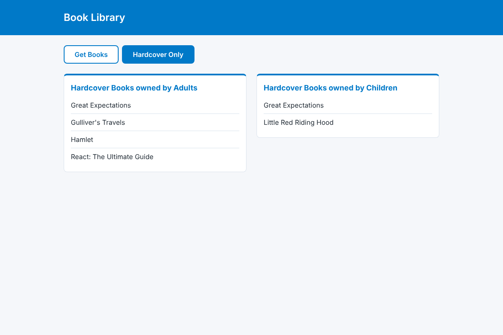
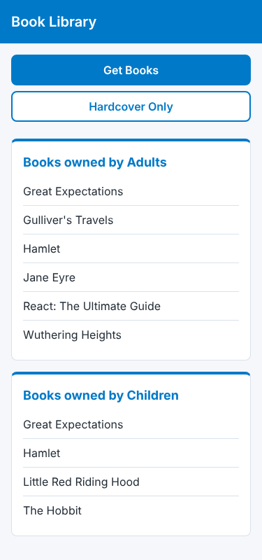

# Book Library: Bupa coding challenge

A React + TypeScript application that fetches book owners from the Bupa coding-test API and lists every book alphabetically, grouped by the owner's age category (**Adults** 18+, **Children** 17 and under), with a **Hardcover only** filter.

| Desktop (≥ 600px)                                                      | Mobile (< 600px)                                        |
| ---------------------------------------------------------------------- | ------------------------------------------------------- |
|  |  |

## Quick start

Requires Node.js 20.19+ (see `.nvmrc`).

```bash
npm ci
npm run dev        # http://localhost:5173, with /api proxied to the upstream API
npm test           # unit + integration tests
npm run ci         # everything CI runs: format, lint, typecheck, coverage gate, build
```

Configuration goes in `.env.local` (see `.env.example`). No secrets are needed.

## How the requirements map to the code

| Requirement                       | Where it lives                                              | Verified by                                                  |
| --------------------------------- | ----------------------------------------------------------- | ------------------------------------------------------------ |
| Fetch API data                    | `features/books/api/bookOwnersApi.ts`                       | `bookOwnersApi.test.ts`                                      |
| Adults ≥ 18, Children ≤ 17        | `features/books/domain/ageCategory.ts` (`ADULT_MIN_AGE`)    | boundary tests for 17 and 18                                 |
| Grouped and alphabetically sorted | `features/books/domain/groupBooks.ts`                       | tests against the **live API payload** captured as a fixture |
| "Get Books"                       | `FilterToolbar.tsx` → `BooksPage.tsx`                       | `App.test.tsx`                                               |
| "Hardcover only"                  | `FILTER_PREDICATES` in `groupBooks.ts`                      | `App.test.tsx`, `groupBooks.test.ts`                         |
| Dynamic headings                  | `features/books/domain/headings.ts`                         | `headingFor` table tests                                     |
| 600px breakpoint                  | `src/index.css` (mobile-first, `@media (min-width: 600px)`) | screenshots above                                            |
| Primary colour `#0079c8`          | `--color-primary` token in `index.css`                      | n/a                                                          |

## Architecture

```
src/
├── config.ts                 Env-driven runtime config (base URL, timeout)
├── lib/
│   ├── http.ts               fetch wrapper: timeout, typed ApiError, correlation id
│   └── logger.ts             Structured logger with a swappable sink
├── components/ErrorBoundary.tsx
└── features/books/
    ├── api/                  Boundary: zod schema, DTO → domain mapping, fetch
    ├── domain/               Pure business rules (no React, no I/O)
    ├── hooks/                TanStack Query: caching, retries, cancellation
    └── components/           Presentational + one container (BooksPage)
```

Data flows one way: **HTTP → validate → map to domain → group/filter/sort → render**. Each arrow is a function that can be tested on its own.

- **Domain logic is pure.** `groupBooksByAgeCategory(owners, filter)` has no knowledge of React or HTTP. Most of the business rules are tested in milliseconds without a DOM.
- **DTOs and domain types are separate.** The API uses `name`/`type`; the domain uses `title`/`format` with a closed union (`'hardcover' | 'paperback' | 'ebook' | 'other'`). If the API changes, only `schema.ts` changes.
- **Exhaustive typing.** Filters, categories and error kinds are unions mapped through `Record<Union, …>` or exhaustive `switch` statements. Adding a new filter is a compile error until its heading and predicate exist.
- **Fetch once, filter on the client.** Switching between "Get Books" and "Hardcover only" is instant and makes no extra request. The dataset is small; see the assumptions below for when that would change.

## Key decisions

Longer write-ups are in [`docs/adr`](docs/adr).

1. **React + TypeScript + Vite** over Power Platform or Blazor. It is the most direct way to show typed domain modelling, automated tests and a CI pipeline in a reviewable Git repo. ([ADR-0001](docs/adr/0001-technology-choice.md))
2. **Same-origin `/api` proxy.** The browser never calls the upstream host directly. That avoids CORS dependence, keeps the upstream URL out of the bundle and leaves room for a BFF or APIM (auth, caching, rate limiting) later without changing frontend code. ([ADR-0002](docs/adr/0002-same-origin-api-proxy.md))
3. **Runtime validation with zod.** The published Swagger document declares **no response schema**, so a TypeScript type alone would be an unchecked assumption. Malformed records are skipped and logged; a payload that is not an array fails loudly. ([ADR-0003](docs/adr/0003-runtime-validation.md))
4. **TanStack Query for server state.** It handles de-duplication (double-clicks), caching, AbortSignal cancellation and retry/backoff without hand-rolled state machines.
5. **Retry only what is transient.** Network errors, timeouts, 5xx, 408 and 429 are retried (max 2, exponential backoff). 4xx and contract errors are not. Retrying is safe because the request is an idempotent `GET`.
6. **Accessibility built in.** Native buttons with `aria-pressed`, labelled `<section>` regions, a polite live region for loading, `role="alert"` for errors, visible focus rings, 44px touch targets and `prefers-reduced-motion`.

## Assumptions

- **Endpoint:** `GET https://digitalcodingtest.bupa.com.au/api/v1/bookowners`. It is unauthenticated and returns `[{ name, age, books: [{ name, type }] }]`. The fixture in `src/test/fixtures` is a verbatim capture from 6 Oct 2026.
- **Age boundary:** 18 and over is an Adult; 17 and under is a Child. Ages must be non-negative integers. Records that fail this are skipped and logged rather than guessed at.
- **"Alphabetical"** means locale-aware (`en-AU`), case-insensitive and numeric-aware ("Book 2" before "Book 10"). Leading articles are **not** ignored ("The Hobbit" sorts under T).
- **Duplicates:** If two owners in the same category own the same title, both copies are listed, because the data is about owned books. In the live data, the repeated titles (_Hamlet_, _Great Expectations_) fall into different categories. Changing this is a one-line change in `groupBooks.ts`.
- **Book type matching** is case-insensitive. Unknown types map to `other`, so they show under "Get Books" but never under "Hardcover only".
- **Owners with `books: null` or no `books` field** count as owning no books.
- **Fetching on demand:** Nothing loads until the user clicks a button, matching "when selected". "Hardcover only" works on its own without clicking "Get Books" first.
- **Data volume** is small. If it grew to thousands of records, filtering and pagination would move server-side (`?type=hardcover&page=…`) and the list would be virtualised.
- **No authentication** is required by the API. See below for what production would need.

## Before releasing to production

Treating this as a real Bupa release, these are the gaps I would close, roughly in priority order:

**Security and compliance**

- Serve through an API gateway or BFF (Azure APIM / Front Door) with **OAuth2/OIDC** (Entra ID) if the data is not public, plus rate limiting and WAF.
- Security headers at the host: a strict **CSP** (`default-src 'self'`), HSTS, `X-Content-Type-Options`, `Referrer-Policy`, `frame-ancestors 'none'`.
- Dependency and code scanning in CI (Dependabot is configured; add CodeQL or Snyk). Pin GitHub Actions to commit SHAs.
- Privacy review: owner names and ages are personal information. The UI never shows them and the logs never record them. Keep it that way, and agree a data-classification and retention policy.

**Reliability and operations**

- Replace the console log sink with **Application Insights** (or equivalent), forward `X-Correlation-ID` end to end, and add web-vitals and error-rate dashboards with alerts.
- Add a circuit breaker and response caching in the BFF, so a slow upstream does not hit every user.
- Add a synthetic availability check against the deployed site.

**Delivery**

- Branch protection on `main`: required CI checks, required review, signed commits.
- Deployment pipeline with environment promotion (dev → test → prod), immutable build artefacts and one-click rollback. Feature flags for risky changes.
- Track **DORA metrics** (deployment frequency, lead time, change failure rate, MTTR) from the pipeline.

**Quality**

- Playwright end-to-end tests against a stubbed API in CI (desktop and mobile viewports) plus automated **axe** accessibility checks.
- Visual regression snapshots for the two breakpoints.
- Contract test against the live API on a schedule, to detect upstream schema drift early.

## Use of AI tooling

This solution was built with an AI coding assistant, under the same rules I would apply in a team:

- **Grounded in evidence:** the live API response and Swagger document were inspected before modelling. The missing response schema is what drove the runtime-validation decision.
- **Constrained by guardrails:** strict `tsconfig` (`noUncheckedIndexedAccess`, `exactOptionalPropertyTypes`), lint with zero warnings, formatting checks, coverage thresholds (90% lines / 85% branches) and CI on every PR. Generated code has to pass the same gates as hand-written code.
- **Reviewed by a person:** I reviewed every line, and the PR template asks reviewers to confirm the same. I am accountable for everything committed under my name, whoever or whatever typed it.

## Scripts

| Script                            | Purpose                                         |
| --------------------------------- | ----------------------------------------------- |
| `npm run dev`                     | Dev server with API proxy                       |
| `npm run build`                   | Typecheck and production build to `dist/`       |
| `npm run preview`                 | Serve the production build locally (with proxy) |
| `npm test` / `npm run test:watch` | Vitest                                          |
| `npm run test:coverage`           | Tests with the coverage gate                    |
| `npm run lint`                    | oxlint (warnings fail the build)                |
| `npm run typecheck`               | `tsc -b`                                        |
| `npm run format` / `format:check` | Prettier                                        |
| `npm run ci`                      | The full CI pipeline locally                    |
