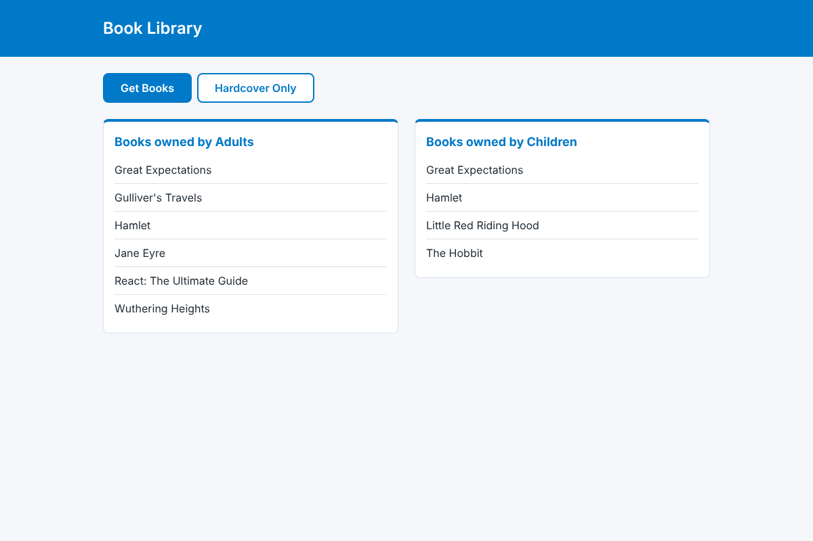

# Owners and Books: Bupa coding challenge

A React app with its own server. The **server** (an ASP.NET Core BFF) fetches the Bupa book-owner API and applies the business rules. The **client** (React + TypeScript) fetches from that server and shows every book alphabetically under the age category of its owner (**Adults** 18+, **Children** 17 and under), with a **Hardcover only** view.

| Desktop (≥ 600px)                                         | Mobile (< 600px)                                                   |
| --------------------------------------------------------- | ------------------------------------------------------------------ |
|  |  |

## Repository layout

```
api/    ASP.NET Core (.NET 10) server: business rules, resilience, caching, OpenAPI contract
web/    React + TypeScript client: fetches from api/, types generated from its OpenAPI document
docs/   Architecture decision records (docs/adr) and screenshots
```

```
Browser ──► web (React) ──/api/v1/books──► api (BFF) ──► Bupa API (/api/v1/bookowners)
                                          rules, cache,      rate-limited, intermittently
                                          retries            returns empty responses
```

## Quick start

Requires the **.NET 10 SDK** and **Node.js 20.19+**. Run the server and the client in two terminals:

```bash
# 1. Server: http://localhost:5080 (API reference at /scalar/v1)
cd api
dotnet run --project src/BupaBooks.Host

# 2. Client: http://localhost:5173 (proxies /api to the server above)
cd web
npm ci
npm run dev
```

### Checks

```bash
cd api
dotnet build                                    # warnings and vulnerable packages fail the build; regenerates openapi/bupa-books.json
dotnet test --filter "Category!=LiveContract"   # unit, adapter, integration and architecture tests (offline)
dotnet test --filter "Category=LiveContract"    # checks the real Bupa API still matches our expectations

cd web
npm run generate:api   # regenerate TypeScript types from the server's OpenAPI document
npm run ci             # format, lint, typecheck, tests with coverage gate, build
```

## How the requirements map to the code

| Requirement                                       | Where it lives                                                                                    | Verified by                               |
| ------------------------------------------------- | ------------------------------------------------------------------------------------------------- | ----------------------------------------- |
| Server side that returns the data                 | `api/` → `GET /api/v1/books?ageCategory=&format=` ([ADR-0004](docs/adr/0004-bff-api-contract.md)) | `Host.IntegrationTests`                   |
| Client side that fetches from our server          | `web/src/features/books/api/booksApi.ts` (same-origin `/api`)                                     | `booksApi.test.ts`, `App.test.tsx`        |
| Must be a React app                               | `web/`                                                                                            | n/a                                       |
| Adults ≥ 18, Children ≤ 17                        | `Application/Domain/Age.cs` (`AdultMinimumAge`)                                                   | `AgeTests` (17 and 18 boundaries)         |
| All books, alphabetical, under their age category | `Application/Domain/BookSelection.cs`, `BookOrdering.cs`                                          | `BookSelectionTests`, using the live data |
| "Get Books" / "Hardcover only"                    | `web/.../BookControls.tsx` → `?format=hardcover` on the server                                    | `App.test.tsx`, `BookSelectionTests`      |
| Dynamic headings                                  | `web/src/features/books/headings.ts`                                                              | `headings.test.ts`, `App.test.tsx`        |
| 600px breakpoint, `#0079c8`, reference layout     | `web/src/index.css` (mobile-first, `@media (min-width: 600px)`)                                   | screenshots above                         |

## Architecture

### Server (`api/`): clean architecture in three projects ([ADR-0005](docs/adr/0005-bff-clean-architecture.md))

```
BupaBooks.Host ─────────► BupaBooks.Application ◄───── BupaBooks.Infrastructure
(endpoint, validation,     (Domain/ model + rules,       (typed HttpClient, resilience,
 problem details, ETag,     GetBooks use case,            HybridCache, anti-corruption
 OpenAPI, telemetry)        paging, IBookOwnerSource)     mapping of Bupa's JSON)
```

- **The server owns every business rule.** The client sends intent (`ageCategory=adult&format=hardcover`); it never sees an age.
- **No personal data leaves the server.** Responses contain `{ id, title, format }` only.
- **Reliability, no cascading failure** ([ADR-0006](docs/adr/0006-upstream-behaviour.md), [ADR-0007](docs/adr/0007-edge-protection-and-cascading-failure.md)):
  - Retries with backoff and jitter for 429/5xx/timeouts and for upstream's empty `200` responses.
  - A bulkhead (at most 10 concurrent upstream calls) and a circuit breaker tuned to actually trip at this traffic.
  - A 5-minute `HybridCache` with stampede protection: one upstream call however many users arrive at once.
  - A **last-known-good fallback**: during an outage, users get data up to an hour old instead of an error.
  - ETag/304, and errors as RFC 9457 problem details with a `traceId` (`429`/`502`/`503` + `Retry-After`/`504`).
- **Edge protection:** a per-client-IP rate limit (token bucket, `429` + `Retry-After`) that only trusts forwarded headers from known proxies, a 15 s request timeout, strict CSP and security headers, no `Server` header, HSTS outside development, and Brotli/gzip compression.
- **Boundaries are enforced by tests**, not convention: `ArchitectureTests` fail the build if the domain depends on anything else, or if Host code (other than `Program.cs`) uses Infrastructure.

### Client (`web/`)

```
web/src/
├── api/schema.d.ts         Generated from the server's OpenAPI document (npm run generate:api)
├── config.ts               Env-driven config (same-origin base URL, timeout)
├── lib/http.ts             fetch wrapper: timeout, typed ApiError, Retry-After, correlation id
├── lib/logger.ts           Structured logger with a swappable sink
└── features/books/
    ├── model.ts            Types derived from the generated contract; filter → request mapping
    ├── headings.ts         "Hardcover Books owned by Adults" (display text, not a business rule)
    ├── api/booksApi.ts     GET /api/v1/books, follows paging cursors
    ├── hooks/useBooks.ts   TanStack Query: one query per category, caching, retries
    └── components/         BooksPage (container), BookCard, BookControls
```

- **One contract, two languages.** The server generates `openapi/bupa-books.json` at build time; the client generates its types from it. A server change that breaks the client is a **compile error**, and CI fails if either generated file is stale.
- **Fetch per view, cache per view.** Each (category, filter) pair is cached, so switching back to a view already seen is instant; the server caches upstream data too.
- **Retry only what is transient.** The client retries `503`/`504`/`429`/network errors, honouring `Retry-After`. It does **not** retry `502`, because the server has already retried the upstream.

## Key decisions

All in [`docs/adr`](docs/adr):

| ADR                                                            | Decision                                                                          |
| -------------------------------------------------------------- | --------------------------------------------------------------------------------- |
| [0001](docs/adr/0001-technology-choice.md)                     | React + TypeScript + Vite client                                                  |
| [0002](docs/adr/0002-same-origin-api-proxy.md)                 | Browser only calls same-origin `/api` (now served by our BFF)                     |
| [0003](docs/adr/0003-runtime-validation.md)                    | Validate untrusted upstream data, skip bad records (moved to the BFF)             |
| [0004](docs/adr/0004-bff-api-contract.md)                      | API contract: filterable, paged books collection; no owner data; id assumption    |
| [0005](docs/adr/0005-bff-clean-architecture.md)                | Three-project clean architecture; domain in Application, enforced by tests        |
| [0006](docs/adr/0006-upstream-behaviour.md)                    | Upstream is rate-limited and intermittently returns empty bodies: retry and cache |
| [0007](docs/adr/0007-edge-protection-and-cascading-failure.md) | Per-IP rate limit, security headers, bulkhead, circuit breaker, stale fallback    |

## Assumptions

- **Server and client.** The brief requires "a server side, to return data similar to the above, and a client side, to fetch the data from your server". We read "data similar to the above" as the grouped output (books under an age-category heading): `GET /api/v1/books?ageCategory=…` returns exactly one heading's books, already filtered and sorted.
- **Upstream endpoint:** `GET https://digitalcodingtest.bupa.com.au/api/v1/bookowners`, unauthenticated, returning `[{ name, age, books: [{ name, type }] }]`. Its Swagger document declares no response schema, so the server validates every record.
- **Identifiers.** The brief describes the data as _"similar to"_ the structure shown, so we assume production data carries stable ids. The test endpoint sends none, so the server derives deterministic ids when they are missing. Clients treat `id` as opaque.
- **Age boundary:** 18 and over is an Adult; 17 and under is a Child. Records with a missing or negative age, or a missing name, are skipped and logged (without personal data).
- **"Alphabetical"** means `en-AU`, case-insensitive and numeric-aware ("Book 2" before "Book 10"), with ties broken by id. Leading articles are **not** ignored ("The Hobbit" sorts under T).
- **Duplicates:** every owned copy is listed. Two adults who both own _Hamlet_ produce two entries with different ids.
- **Book types** match case-insensitively. Unknown types become `other`: shown under "Get Books", never under "Hardcover only".
- **Fetching on demand:** nothing loads until the user clicks a button. "Hardcover only" works without clicking "Get Books" first.
- **Data volume** is small; the client still follows paging cursors (100 per page) so it keeps working if it grows.

## Before releasing to production

**Hosting and security**

- Serve the React build from the BFF (`wwwroot`, already wired with an SPA fallback) as one container, behind Azure Front Door/APIM with WAF.
- Add **OAuth2/OIDC** (Entra ID) if the data is not public: the endpoint group is ready for `.RequireAuthorization()`.
- With more than one instance, move per-client rate limiting to the gateway (or a distributed limiter), and set `ForwardedHeaders:KnownProxies` to the gateway's addresses.
- Add CodeQL scanning; pin GitHub Actions to commit SHAs.

**Reliability and operations**

- Point the OpenTelemetry exporter at Application Insights; alert on the skipped-record, upstream-failure and stale-data log events (1001 to 1005), on 429 rates and on 5xx rates.
- Use a distributed cache (Redis) behind `HybridCache` when running more than one instance.
- Synthetic availability check against the deployed site; the scheduled upstream contract test already covers Bupa's side.

**Delivery and quality**

- Branch protection on `main`, environment promotion with immutable artefacts and one-click rollback; track **DORA metrics** from the pipeline.
- Playwright end-to-end tests against the real BFF with a stubbed upstream, plus automated **axe** accessibility checks and visual snapshots at both breakpoints.

## Use of AI tooling

This solution was built with an AI coding assistant, under the same rules I would apply in a team:

- **Grounded in evidence:** the live API, its Swagger document and the challenge page were inspected before designing. The missing schema, the empty responses and the rate limiting each drove a design decision.
- **Constrained by guardrails:** strict compilers on both sides (TypeScript `strict` + `exactOptionalPropertyTypes`; C# nullable + warnings as errors), NuGet vulnerability audit, lint with zero warnings, coverage thresholds, architecture tests, contract drift checks and CI on every PR. Generated code passes the same gates as hand-written code.
- **Reviewed by a person:** I reviewed every line and can explain it. I am accountable for everything committed under my name, whoever or whatever typed it.
